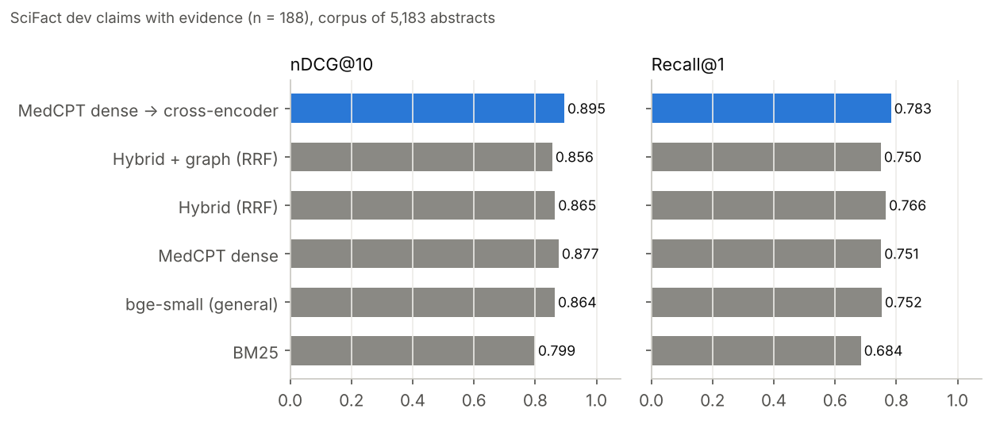
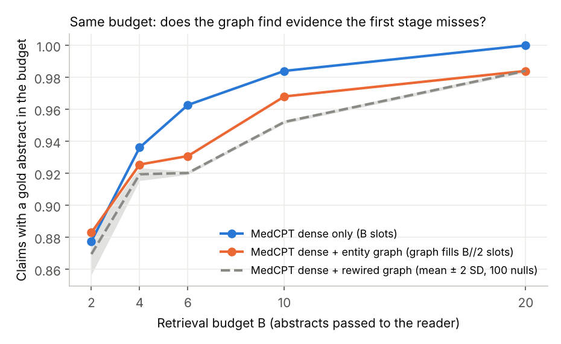
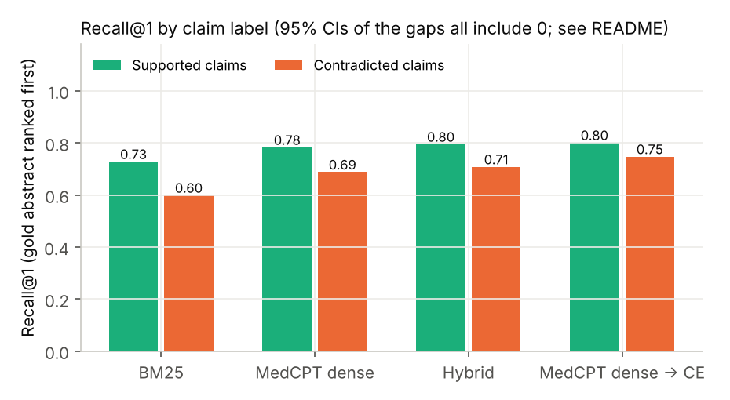
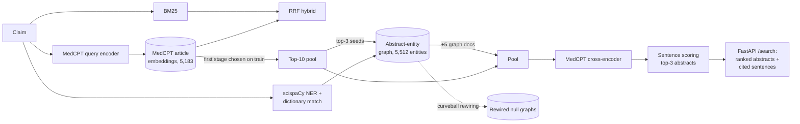

# Biomedical Evidence Retrieval: Does an Entity Graph Help, or Just the Extra Documents?

GraphRAG systems add a knowledge graph to retrieval and usually report a gain over a vector-only
baseline. Two things change at once in that comparison: the graph is added, **and** more documents
reach the reader. This project separates them on a biomedical fact-checking benchmark. It compares graph
expansion against (1) a baseline given the same number of extra documents and (2) the same expansion
run over a **degree-preserving rewired graph**, a null model that keeps every abstract's entity count
and every entity's frequency but scrambles which abstracts share which entities.

It also audits a second question that matters for clinical use: **is evidence for claims that the
literature contradicts harder to retrieve than evidence for claims it supports?** A retriever with that
asymmetry would feed a RAG system a one-sided view.

The retrieval side is a complete RAG service: BM25, two dense retrievers, reciprocal-rank fusion,
entity-graph expansion, a cross-encoder reranker, sentence-level evidence selection with citations,
and a FastAPI endpoint. Answer generation is deliberately left out: every number below measures the
evidence a reader would receive, which bounds how faithful any generated answer can be.

## Results (SciFact dev, 188 claims with annotated evidence, 5,183 PubMed abstracts)

All choices (first-stage retriever, graph parameters) were made on the 505 training claims; the dev
claims were used once. Confidence intervals are 95% bootstrap intervals resampling claims in clusters
by gold abstract; p-values are paired sign-flip tests (10,000 permutations).

### 1. Retrieval pipeline (before / after)

| System | nDCG@10 | Recall@1 | Recall@10 |
|---|---|---|---|
| BM25 | 0.799 | 0.684 | 0.901 |
| bge-small-en-v1.5 (general-domain dense) | 0.864 | 0.752 | 0.957 |
| MedCPT (biomedical dense) | 0.877 | 0.751 | 0.972 |
| Hybrid: BM25 + MedCPT (RRF) | 0.865 | 0.766 | 0.950 |
| **MedCPT → MedCPT cross-encoder (top 10 reranked)** | **0.895** | **0.783** | **0.972** |

- The final system improves on BM25 by **+0.096 nDCG@10** (CI 0.059 to 0.135, p = 0.0001) and
  **+0.098 Recall@1** (CI 0.045 to 0.151, p = 0.0004).
- Fusing BM25 into MedCPT did **not** help: Recall@10 fell 0.023 (CI −0.052 to 0.005). The training
  claims showed the same thing (gold abstract in the top 10: 0.988 for MedCPT vs 0.962 for hybrid), so
  the pipeline selected MedCPT alone as its first stage.
- The cross-encoder's gain over MedCPT alone is small and not significant on 188 claims:
  +0.018 nDCG@10 (CI −0.008 to 0.043, p = 0.17).
- Sentence-level evidence (supporting-fact recall): the 5 top-scored sentences from the top 3 abstracts
  contain **71.8%** of the annotated rationale sentences (BM25 documents: 65.3%); the top 10 contain 83.6%.



### 2. The entity graph: real signal, but no gain once the budget is matched

The graph links abstracts through 5,512 chemicals, diseases, genes, proteins and cell types
(scispaCy BC5CDR + JNLPBA NER; 28,439 abstract-entity edges; each entity appears in at least 2 and at most 5% of the abstracts).

| Comparison (after reranking) | Δ nDCG@10 | Δ Recall@10 |
|---|---|---|
| 10 MedCPT docs + 5 graph docs vs 10 MedCPT docs (the usual GraphRAG comparison) | +0.001 (CI −0.003 to 0.006) | +0.005 (CI 0.000 to 0.013) |
| 10 MedCPT + 5 graph vs **15 MedCPT docs (budget-matched)** | +0.001 (CI −0.003 to 0.005) | +0.002 (CI −0.004 to 0.009) |
| real graph vs 5 rewired graphs | 0.896 vs 0.895 (all 5 nulls identical) | 0.977 vs 0.972 (p = 0.17, the minimum with 5 nulls) |

- The 10-document pool already contains a gold abstract for 185 of 188 claims. The graph recovered
  none of the 3 misses; five more MedCPT documents recovered 1.
- **Fixed context budget** (no reranker): with B abstracts allowed and the graph filling B/2 of them,
  graph documents beat rewired-graph documents at B = 2 to 10 (p ≤ 0.05, 100 rewirings), so the graph
  does carry information. But they are worse than the MedCPT documents they displace at every budget
  from 4 up (e.g. B = 6: 0.931 vs 0.963 of claims with gold evidence).
- Fusing the graph ranking into the hybrid ranking (RRF, weight tuned on train) lowered nDCG@10 by 0.009
  (CI −0.020 to 0.000) and was indistinguishable from fusing a rewired graph (0.856 vs null 0.858 ± 0.0005).



**Reading.** On single-hop biomedical claims with a strong biomedical dense retriever, an entity graph
adds no measurable evidence. The "+graph beats baseline" comparison would have looked slightly positive
on Recall@10; the budget-matched and rewired-graph controls show that this is the effect of extra slots.
One design detail mattered a lot: an earlier version that excluded the seed abstracts from the graph
ranking before fusion cut Recall@1 by 0.16, because RRF then promoted graph neighbours above the best
first-stage hits. That version is not reported above; the code now keeps seeds in the graph ranking.

### 3. Stance audit: supported vs contradicted claims

| System | Recall@1 SUPPORT (n=124) | Recall@1 CONTRADICT (n=64) | Gap (95% CI) |
|---|---|---|---|
| BM25 | 0.728 | 0.599 | 0.130 (−0.009 to 0.273) |
| MedCPT | 0.783 | 0.688 | 0.095 (−0.033 to 0.220) |
| Hybrid | 0.795 | 0.708 | 0.087 (−0.039 to 0.211) |
| MedCPT → cross-encoder | 0.801 | 0.747 | 0.054 (−0.061 to 0.178) |

- Every system ranks the gold abstract first more often for supported claims, but no gap is
  significant once claims are clustered by their evidence abstract.
- 17 abstracts are the gold evidence for both a supported and a contradicted claim. Within those
  pairs, which share the evidence and differ in stance, there is no consistent difference
  (e.g. MedCPT: 1 pair favours SUPPORT, 1 favours CONTRADICT, 15 tie).
- So the evidence does not show a stance bias; the raw gap is more likely about which abstracts the
  contradicted claims come from. With 64 contradicted claims the audit can only rule out large effects.
  The reranker narrows the raw gap from 0.095 to 0.054.



Full numbers, the training-set tuning log and all comparisons: [`results/scifact/metrics.json`](results/scifact/metrics.json);
per-claim scores: `results/scifact/per_claim_dev.json`.

## Architecture



## Method

**Data.** SciFact (Wadden et al., 2020): 5,183 PubMed abstracts and expert-written claims, each
annotated with the abstracts and rationale sentences that support or contradict it. Training claims:
809 (505 with evidence). Dev claims: 300 (188 with evidence). The test split has no public labels and
is not used. Claims without evidence are excluded from every metric. The loader checks that every
gold abstract exists and every rationale index is a valid sentence.

**Retrievers.**
- BM25 (k1 = 0.9, b = 0.4) on title + abstract.
- `ncbi/MedCPT-Query-Encoder` / `ncbi/MedCPT-Article-Encoder` (inner product of [CLS] embeddings,
  article input = [title, abstract], 512 tokens) and `BAAI/bge-small-en-v1.5` as a general-domain control.
- Hybrid = reciprocal-rank fusion (k = 60) of the BM25 and MedCPT top 100.
- Reranker: `ncbi/MedCPT-Cross-Encoder` on (claim, title + abstract), and on (claim, sentence) for evidence selection.

**Entity graph.** Entities are scispaCy NER mentions (`en_ner_bc5cdr_md`, `en_ner_jnlpba_md`),
normalised by lower-casing and removing hyphens and slashes; there is no ontology linking.
Entities in fewer than 2 abstracts (they link nothing) or more than 5% (e.g. "cancer") are dropped.
Expansion activates entities from the claim and from the top-3 seed abstracts (rank-discounted,
idf-weighted) and scores every abstract by its summed activation / sqrt(#entities).
Tuned on train (pool gold-hit rate, ties broken toward fewer seeds): 3 seeds, claim-entity weight 0
(adding claim entities did not raise the training objective; most settings tied within 0.002), 5 graph docs.

**Null model.** Curveball algorithm (Strona et al., 2014): repeated trades of entities between random
pairs of abstracts. Each rewired graph has exactly the same abstract degrees and entity frequencies as
the real one, so idf weights and graph density are unchanged. Unit tests check both degree sequences.

## Limitations

- SciFact claims are mostly single-hop (178 of 188 dev claims cite one evidence abstract) and the corpus
  is small, so a strong dense retriever leaves little to recover (3 of 188 claims missed by the pool).
  A graph may help on multi-hop questions or million-abstract corpora; this study does not test that.
- MedCPT was trained on PubMed search logs, and SciFact's abstracts are in PubMed, so its scores may
  partly reflect exposure to these documents.
- Entities are surface strings without normalisation to an ontology (no UMLS/MeSH linking), which
  under-connects synonyms.
- The reranked null used 5 rewirings (the cross-encoder is the CPU cost); the fixed-budget and fusion
  nulls used 100 and 200.
- 188 dev claims give wide intervals; differences under about 0.03 nDCG@10 cannot be resolved.

## Run

```bash
pip install -r requirements-models.txt
bash scripts/download_data.sh                # SciFact -> data/scifact
python scripts/download_models.py            # scispaCy NER models -> models/ (Hugging Face models download on first use)
python scripts/build_index.py --data-dir data/scifact --cache-dir cache --encoders medcpt bge \
    --ner-models models/en_ner_bc5cdr_md models/en_ner_jnlpba_md
python scripts/run_experiment.py --data-dir data/scifact --cache-dir cache --out results/scifact
python scripts/make_figures.py --results results/scifact --out figures/scifact
python scripts/serve.py --data-dir data/scifact --cache-dir cache --params results/scifact/metrics.json
# curl -X POST localhost:8000/search -H 'content-type: application/json' -d '{"claim": "Metformin reduces cancer incidence in type 2 diabetes."}'
```

On a 4-vCPU machine without a GPU: MedCPT corpus embedding about 20 min, NER about 3 min, and the
experiment about 35 min (13 min when the cross-encoder cache is warm). Seed 2025.

`download_models.py` rewrites two booleans in the scispaCy v0.5.4 configs from the strings
`"True"`/`"False"` to real booleans, which spaCy 3.8's config validation requires. Nothing else is changed.

Tests and smoke test (synthetic data; checks that the code runs, says nothing about results):

```bash
pip install -r requirements.txt
pytest -q
python scripts/make_synthetic.py --out data/synthetic
python scripts/run_experiment.py --data-dir data/synthetic --out results/synthetic_smoke --smoke
python scripts/serve.py --data-dir data/synthetic --smoke
```

## Layout

```
evidence_rag/
  data.py        SciFact loader and integrity checks
  sparse.py      BM25
  dense.py       MedCPT / sentence-transformers / LSA encoders, embedding cache
  entities.py    NER wrappers, normalisation, abstract-entity matrix
  graph.py       entity expansion, curveball rewiring
  fusion.py      top-k, reciprocal-rank fusion
  rerank.py      cross-encoder, cached scorer
  metrics.py     recall/nDCG/MRR, rationale recall, clustered bootstrap, sign-flip tests
  experiment.py  first-stage selection, tuning, evaluation, null models, stance audit
  api.py         FastAPI service
scripts/         download, index, run, figures, serve, synthetic data
tests/           unit tests and a synthetic end-to-end test of the experiment and API
```

## References

- Wadden, D. et al. (2020). Fact or Fiction: Verifying Scientific Claims. EMNLP 2020. https://arxiv.org/abs/2004.14974 (data: https://github.com/allenai/scifact)
- Jin, Q. et al. (2023). MedCPT: Contrastive Pre-trained Transformers with large-scale PubMed search logs for zero-shot biomedical information retrieval. Bioinformatics 39(11), btad651.
- Neumann, M. et al. (2019). ScispaCy: Fast and Robust Models for Biomedical Natural Language Processing. BioNLP 2019.
- Cormack, G. V., Clarke, C. L. A. & Büttcher, S. (2009). Reciprocal rank fusion outperforms Condorcet and individual rank learning methods. SIGIR 2009.
- Strona, G. et al. (2014). A fast and unbiased procedure to randomize ecological binary matrices with fixed row and column totals. Nature Communications 5, 4114.

Data and model licences are set by their owners; see the SciFact repository and the Hugging Face model cards.
